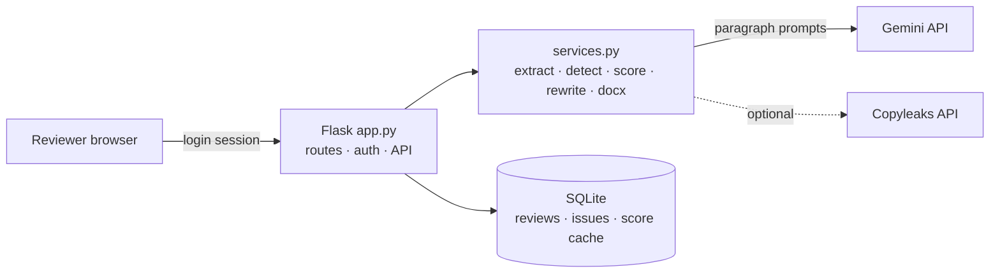

# Kashef — AI-Assisted Report Review Tool

**كاشف** is a local web tool for managers and heads of department to review staff reports and research papers (Arabic and English): estimate AI-generated passages paragraph by paragraph, log factual and language errors, rewrite flagged parts, and export the approved text and a review report as Word documents.


> النسخة العربية: [README.ar.md](README.ar.md)

## 1. Project Overview

Built for a government department that started receiving reports written largely with AI tools. Kashef gives reviewers one place to scan a document, see which paragraphs look machine-written, record concrete errors (wrong facts, missing references, wrong numbers or dates, off-topic content, language errors), and produce a clean final version.

## 2. Problem Statement

- Reviewers had no consistent way to check long Arabic reports for AI-generated content.
- Generic AI detectors give one number per document, change their answer on every run, and say nothing about *which* paragraph is the problem.
- Feedback to staff was verbal and undocumented.

## 3. Solution

- **Paragraph-level scoring** with Gemini: each new paragraph is scored **3 times and the median is kept**, then cached by content hash — re-scanning the same text always returns the same percentage.
- Editing a paragraph re-scores **only that paragraph**.
- A structured **error log** per review, so accountability is based on documented errors, not on a percentage.
- **Rewrite** of selected ranges that protects numbers, dates and names (the tool checks that none were lost).
- **Word export** of the final text and of the review report, with correct RTL formatting.

## 4. Features

- Upload PDF or Word, or paste text (100 – 100,000 characters)
- Language detection (Arabic / English)
- AI-likelihood per paragraph and for the whole document
- Optional paid **Copyleaks** detector instead of Gemini
- Demo mode without any API key
- Error categories, review history, export to `.docx`
- Single-password login; runs on `127.0.0.1` only by default

## 5. Technology Stack

| Layer | Technology |
|---|---|
| Back end | Python 3.10+, Flask |
| AI | Google Gemini API (primary + fallback model), optional Copyleaks API |
| Documents | `pypdf` (PDF text), `python-docx` (read/write Word, RTL) |
| Database | SQLite |
| Front end | Server-rendered HTML + vanilla JavaScript |
| Tests | pytest (18 tests) |

## 6. System Architecture



`app.py` handles HTTP, sessions and persistence; `services.py` holds all document and AI logic and is unit-tested with a fake model, so tests run offline.

## 7. Database Design

| Table | Purpose |
|---|---|
| `reviews` | One reviewed document: employee, title, original text, language, AI score, final text, timestamps |
| `issues` | Errors logged against a review (`kind`, `excerpt`, `note`), deleted with the review |
| `paragraph_scores` | Paragraph hash → median score and reason, so identical text always gets the same result |

## 8. Security Considerations

| Area | Implementation |
|---|---|
| Access | Single shared password from `.env`, compared in constant time (`hmac.compare_digest`); empty passwords are rejected; the app refuses to start with a password shorter than 8 characters |
| Sessions | Random secret key generated on first run and stored outside the repo (`.secret`) |
| Network exposure | Binds to `127.0.0.1` by default (no HTTPS, so it is not exposed to the LAN) |
| Secrets | API keys only in `.env`; `.env`, `.secret` and the database are git-ignored |
| Uploads | 25 MB request limit; text length limits |
| Data privacy | The README warns that the free Gemini tier may use submitted text — confidential documents should not be uploaded |

## 9. Screenshots / Demo

Screenshots will be added to `docs/screenshots/`. Without an API key the tool runs in **demo mode** with sample scores, so it can be tried immediately.

## 10. Installation & Setup

```bash
python -m venv .venv
.venv\Scripts\activate            # Windows  (source .venv/bin/activate on Linux/macOS)
pip install -r requirements.txt
copy .env.example .env            # cp on Linux/macOS
# set APP_PASSWORD (8+ chars) and GEMINI_API_KEY (free key from Google AI Studio)
python app.py
```

On Windows, `run.bat` creates the virtual environment and `.env` for you.

Tests: `python -m pytest -q tests`

## 11. Future Improvements

- Per-user accounts and roles instead of one shared password
- Side-by-side diff of original vs rewritten paragraphs
- Batch review of several documents and a department dashboard
- Self-hosted / on-premise model option so documents never leave the network

## 12. Project Status

**In use** — developed for an internal department workflow; actively maintained.

> The AI score is an indicator, not proof. Decisions should rely on the documented errors.
